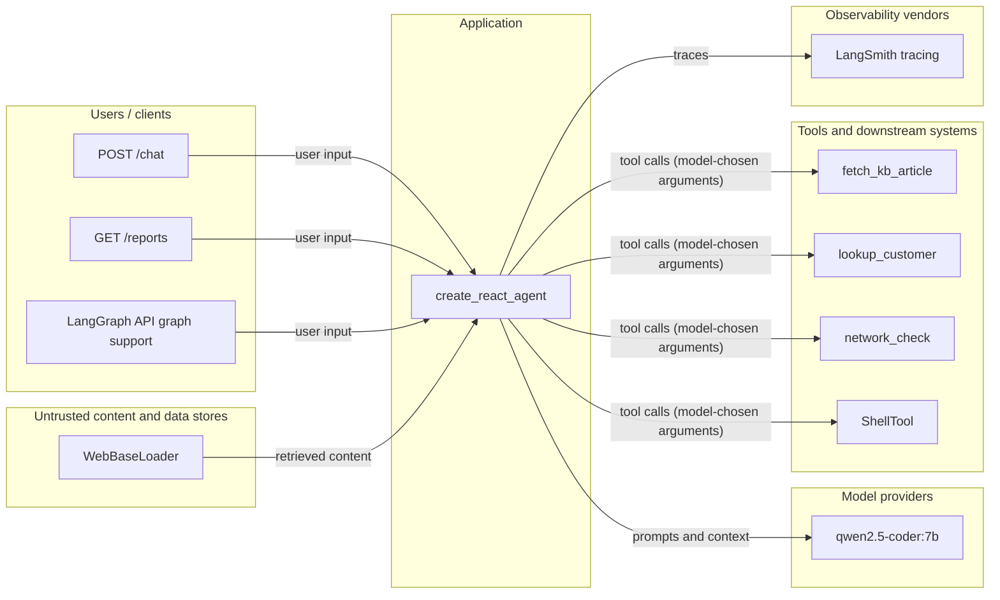

# AI Threat Model

- **Project:** `vulnerable_support_agent`
- **Generated:** 2026-11-13T21:57:23+00:00 by ai-threat-model 0.1.0
- **Frameworks:** LangChain, LangGraph
- **Files scanned:** 7

## Summary

| Critical | High | Medium | Low | Info |
|---:|---:|---:|---:|---:|
| 2 | 6 | 9 | 3 | 0 |

## Architecture

## Trust boundaries

| ID | Boundary | From | To | Components | Why it matters |
|---|---|---|---|---:|---|
| TB-1 | Users to application | External users | Application | 3 | Requests, chat messages, and uploads enter the application. All content is attacker-controllable. |
| TB-2 | Application to local model runtime | Application | Local model runtime | 1 | Prompts stay on local infrastructure, but model responses are still untrusted output. |
| TB-3 | External content to model context | Documents, web, and data stores | Model context window | 1 | Retrieved or fetched content is concatenated into prompts and can carry indirect prompt injection. |
| TB-4 | Model decisions to tool execution | Model output | Tools and downstream systems | 4 | The model chooses which tools run and with which arguments; tool arguments are attacker-influenced. |
| TB-5 | Application to observability vendor | Application | Tracing / logging vendor | 1 | Traces include full prompts, tool arguments, and outputs. |

## Inventory

### Entry points (3)

| Name | Location | Details |
|---|---|---|
| POST /chat | `app/main.py:23` | auth: not detected; handler: chat; interface: HTTP |
| GET /reports | `app/main.py:32` | auth: not detected; handler: run_report; interface: HTTP |
| LangGraph API graph 'support' | `langgraph.json:4` | auth: platform default; interface: HTTP (LangGraph Platform); target: ./app/agent.py:build_agent |

### Model calls (1)

| Name | Location | Details |
|---|---|---|
| qwen2.5-coder:7b | `app/agent.py:24` | base_url: http://127.0.0.1:11434; local: yes; provider: ollama |

### Agents (1)

| Name | Location | Details |
|---|---|---|
| create_react_agent | `app/agent.py:57` | factory: create_react_agent; tools: tools |

### Tools (4)

| Name | Location | Details |
|---|---|---|
| fetch_kb_article | `app/agent.py:33` | function: fetch_kb_article; source: @tool |
| lookup_customer | `app/agent.py:40` | capabilities: SQL execution; function: lookup_customer; source: @tool |
| network_check | `app/agent.py:49` | capabilities: command execution; function: network_check; source: @tool |
| ShellTool | `app/agent.py:56` | capabilities: arbitrary shell command execution; dangerous: yes |

### Retrieval sources (1)

| Name | Location | Details |
|---|---|---|
| WebBaseLoader | `app/agent.py:35` | trust: untrusted external content |

### Observability (1)

| Name | Location | Details |
|---|---|---|
| LangSmith tracing | `config/settings.yaml:2` | vendor: LangSmith |

## Findings

### Critical (2)

#### [AITM-TOOL-003] Model-controlled tool argument reaches a dangerous sink

- **Location:** `app/agent.py:51`
- **Category:** LLM06 Excessive Agency
- **Confidence:** high
- **OWASP Agentic:** ASI02 Tool Misuse and Exploitation, ASI05 Unexpected Code Execution
- **Code:** `return run_network_check(host) # AITM-TOOL-003 (interprocedural): reaches a shell in system_utils.py`

Tool `network_check` passes a model-controlled argument to `subprocess.run` (command execution). A prompt-injected model chooses this value. The data passes through `run_network_check()` parameter `host` and reaches the sink at app/system_utils.py:12.

Related locations:
- `app/system_utils.py:12`
- `app/agent.py:49`

**Recommendation:** Validate tool arguments against a strict schema and allow-list. Use parameterized queries, argument arrays without a shell, and path/URL allow-lists.

#### [AITM-TOOL-001] High-risk built-in tool exposed to the model

- **Location:** `app/agent.py:56`
- **Category:** LLM06 Excessive Agency
- **Confidence:** high
- **OWASP Agentic:** ASI02 Tool Misuse and Exploitation, ASI05 Unexpected Code Execution
- **Code:** `tools = [fetch_kb_article, lookup_customer, network_check, ShellTool()] # AITM-TOOL-001: ShellTool`

`ShellTool` gives the model arbitrary shell command execution.

**Recommendation:** Remove the tool or replace it with a narrowly scoped tool that validates arguments, runs in a sandbox, and requires human approval.

### High (6)

#### [AITM-DATA-001] Hard-coded secret

- **Location:** `app/agent.py:20`
- **Category:** LLM02 Sensitive Information Disclosure
- **Confidence:** high
- **OWASP Agentic:** ASI03 Identity and Privilege Abuse
- **Code:** `SUPPORT_API_KEY = "acme…[REDACTED]" # AITM-DATA-001: hard-coded credential`

`SUPPORT_API_KEY` is set to a literal credential (acme…[REDACTED]).

**Recommendation:** Revoke and rotate the credential, remove it from source and history, and load it from a secret manager or untracked environment configuration.

#### [AITM-TOOL-003] Model-controlled tool argument reaches a dangerous sink

- **Location:** `app/agent.py:44`
- **Category:** LLM06 Excessive Agency
- **Confidence:** high
- **OWASP Agentic:** ASI02 Tool Misuse and Exploitation, ASI05 Unexpected Code Execution
- **Code:** `row = connection.execute(f"SELECT name, plan FROM customers WHERE id = '{customer_id}'").fetchone()`

Tool `lookup_customer` passes a model-controlled argument to `connection.execute` (SQL execution). A prompt-injected model chooses this value.

Related locations:
- `app/agent.py:40`

**Recommendation:** Validate tool arguments against a strict schema and allow-list. Use parameterized queries, argument arrays without a shell, and path/URL allow-lists.

#### [AITM-PI-003] Indirect prompt injection: external content reaches an agent with privileged tools

- **Location:** `app/agent.py:57`
- **Category:** LLM01 Prompt Injection
- **Confidence:** medium
- **OWASP Agentic:** ASI01 Agent Goal Hijack, ASI06 Memory and Context Poisoning
- **Code:** `return create_react_agent(llm, tools, prompt=SYSTEM_PROMPT)`

Untrusted external content (`WebBaseLoader`) can reach agent context while the agent can call side-effecting tools (`ShellTool`, `lookup_customer`, `network_check`). Instructions hidden in fetched content can trigger those tools.

Related locations:
- `app/agent.py:35`
- `app/agent.py:40`
- `app/agent.py:49`
- `app/agent.py:56`

**Recommendation:** Treat retrieved and fetched content as data: isolate it from tool-calling agents, restrict tools to least privilege, and require human approval for side effects.

#### [AITM-OUT-002] Model output rendered as trusted HTML or template

- **Location:** `app/main.py:28`
- **Category:** LLM05 Improper Output Handling
- **Confidence:** medium
- **OWASP Agentic:** ASI09 Human-Agent Trust Exploitation
- **Code:** `return HTMLResponse(f"&lt;div class='answer'&gt;{answer}&lt;/div&gt;") # AITM-OUT-002: model output rendered as HTML`

Model output is rendered as trusted markup via `fastapi.responses.HTMLResponse` (XSS / template injection).

**Recommendation:** HTML-escape model output, render it as text or sanitized Markdown, and never mark it as safe markup.

#### [AITM-OUT-001] Model output reaches a dangerous sink

- **Location:** `app/main.py:35`
- **Category:** LLM05 Improper Output Handling
- **Confidence:** medium
- **OWASP Agentic:** ASI05 Unexpected Code Execution, ASI02 Tool Misuse and Exploitation
- **Code:** `rows = connection.execute(sql).fetchall() # AITM-OUT-001: model-written SQL executed`

Model output flows into `connection.execute` (SQL execution) in `run_report`.

**Recommendation:** Treat model output as untrusted input. Parse it into a validated structure and never pass it to eval, shells, raw SQL, file paths, or URLs.

#### [AITM-DATA-001] Hard-coded secret

- **Location:** `config/settings.yaml:4`
- **Category:** LLM02 Sensitive Information Disclosure
- **Confidence:** medium
- **OWASP Agentic:** ASI03 Identity and Privilege Abuse
- **Code:** `DATABASE_PASSWORD: "acme…[REDACTED]"`

`DATABASE_PASSWORD` holds a literal credential (acme…[REDACTED]).

**Recommendation:** Revoke and rotate the credential, remove it from source and history, and load it from a secret manager or untracked environment configuration.

### Medium (9)

#### [AITM-DATA-005] Credential embedded in a system prompt

- **Location:** `app/agent.py:27`
- **Category:** LLM07 System Prompt Leakage
- **Confidence:** medium
- **OWASP Agentic:** ASI03 Identity and Privilege Abuse
- **Code:** `SYSTEM_PROMPT = SystemMessage(`

The system prompt text appears to contain a credential.

**Recommendation:** Assume system prompts can be extracted. Remove credentials and sensitive rules from prompts and enforce authorization outside the model.

#### [AITM-ID-001] Tool takes an object or identity reference from the model (confused deputy)

- **Location:** `app/agent.py:40`
- **Category:** LLM06 Excessive Agency
- **Confidence:** medium
- **OWASP Agentic:** ASI03 Identity and Privilege Abuse, ASI02 Tool Misuse and Exploitation
- **Code:** `def lookup_customer(customer_id: str) -&gt; str:`

Tool `lookup_customer` lets the model choose `customer_id` and receives no caller identity (no InjectedToolArg/InjectedState/config). A prompt-injected model can act on other users' records with the agent's privileges (IDOR / confused deputy).

**Recommendation:** Inject the caller's identity into the tool (InjectedToolArg, InjectedState, or the RunnableConfig) and authorize every object access against it; never trust IDs chosen by the model.

#### [AITM-TOOL-005] No human approval before side-effecting tool calls

- **Location:** `app/agent.py:57`
- **Category:** LLM06 Excessive Agency
- **Confidence:** medium
- **OWASP Agentic:** ASI02 Tool Misuse and Exploitation, ASI09 Human-Agent Trust Exploitation
- **Code:** `return create_react_agent(llm, tools, prompt=SYSTEM_PROMPT)`

Side-effecting tools (`ShellTool`, `lookup_customer`, `network_check`) run without any detected human approval step (no LangGraph interrupt, interrupt_before/after, or human-in-the-loop middleware).

Related locations:
- `app/agent.py:40`
- `app/agent.py:49`
- `app/agent.py:56`

**Recommendation:** Use LangGraph interrupts (interrupt_before / interrupt()) or human-in-the-loop middleware so a person approves destructive or external actions.

#### [AITM-AUTH-001] LLM entry point has no detected authentication

- **Location:** `app/main.py:23`
- **Category:** LLM10 Unbounded Consumption
- **Confidence:** low
- **OWASP Agentic:** ASI03 Identity and Privilege Abuse
- **Code:** `def chat(body: ChatRequest) -&gt; HTMLResponse:`

`POST /chat` exposes LLM functionality without detected authentication; anyone who can reach it can spend model quota and drive connected tools.

**Recommendation:** Require authentication and authorization on the endpoint, and add rate limits and usage quotas to protect model spend and connected tools.

#### [AITM-DATA-003] Sensitive data written to logs or debug output

- **Location:** `app/main.py:24`
- **Category:** LLM02 Sensitive Information Disclosure
- **Confidence:** medium
- **Code:** `logger.info("Chat from %s: %s", body.customer_email, body.message) # AITM-DATA-003: PII in logs`

Personal data is written to logs via `logger.info`.

**Recommendation:** Disable verbose/debug modes in production and redact secrets and personal data before logging prompts, responses, or tool arguments.

#### [AITM-DATA-002] Secret or personal data sent to a model

- **Location:** `app/main.py:26`
- **Category:** LLM02 Sensitive Information Disclosure
- **Confidence:** medium
- **Code:** `result = support_agent.invoke({"messages": [("user", f"Customer {body.customer_email} says: {body.message}")]})`

Personal data is sent to the model via .invoke().

**Recommendation:** Minimize and redact data before prompting. Confirm the provider's retention terms and keep credentials out of prompts entirely.

#### [AITM-PI-001] Untrusted input concatenated into a prompt

- **Location:** `app/main.py:26`
- **Category:** LLM01 Prompt Injection
- **Confidence:** medium
- **OWASP Agentic:** ASI01 Agent Goal Hijack
- **Code:** `result = support_agent.invoke({"messages": [("user", f"Customer {body.customer_email} says: {body.message}")]})`

User input is formatted directly into .invoke(); it is not delimited from instructions and braces in the input can inject template variables.

**Recommendation:** Pass user input as a separate template variable or human message; never splice it into instructions. Delimit untrusted text and validate its length and format.

#### [AITM-AUTH-001] LLM entry point has no detected authentication

- **Location:** `app/main.py:32`
- **Category:** LLM10 Unbounded Consumption
- **Confidence:** low
- **OWASP Agentic:** ASI03 Identity and Privilege Abuse
- **Code:** `def run_report(question: str) -&gt; dict:`

`GET /reports` exposes LLM functionality without detected authentication; anyone who can reach it can spend model quota and drive connected tools.

**Recommendation:** Require authentication and authorization on the endpoint, and add rate limits and usage quotas to protect model spend and connected tools.

#### [AITM-PI-001] Untrusted input concatenated into a prompt

- **Location:** `app/main.py:33`
- **Category:** LLM01 Prompt Injection
- **Confidence:** medium
- **OWASP Agentic:** ASI01 Agent Goal Hijack
- **Code:** `sql = llm.invoke(f"Write one SQLite query that answers: {question}").content # AITM-PI-001`

User input is formatted directly into .invoke(); it is not delimited from instructions and braces in the input can inject template variables.

**Recommendation:** Pass user input as a separate template variable or human message; never splice it into instructions. Delimit untrusted text and validate its length and format.

### Low (3)

#### [AITM-DATA-003] Sensitive data written to logs or debug output

- **Location:** `app/agent.py:22`
- **Category:** LLM02 Sensitive Information Disclosure
- **Confidence:** high
- **Code:** `set_debug(True) # AITM-DATA-003: prints full prompts and tool arguments`

`set_debug(True)` prints full prompts, tool arguments, and responses to stdout/logs.

**Recommendation:** Disable verbose/debug modes in production and redact secrets and personal data before logging prompts, responses, or tool arguments.

#### [AITM-DATA-004] Prompts and outputs exported to a third-party tracing service

- **Location:** `config/settings.yaml:2`
- **Category:** LLM02 Sensitive Information Disclosure
- **Confidence:** high
- **Code:** `LANGSMITH_TRACING: "true"`

`LANGSMITH_TRACING=true` sends prompts, tool arguments, and model outputs to LangSmith.

**Recommendation:** Confirm tracing is intended for this environment, mask inputs/outputs containing personal data, and review the vendor's retention policy.

#### [AITM-SUP-001] AI framework dependency is not pinned

- **Location:** `requirements.txt:2`
- **Category:** LLM03 Supply Chain
- **Confidence:** medium
- **OWASP Agentic:** ASI04 Agentic Supply Chain Vulnerabilities
- **Code:** `langchain&gt;=0.3`

Unpinned AI dependencies: langchain, langchain-community, langchain-ollama, langgraph.

Related locations:
- `requirements.txt:3`
- `requirements.txt:4`
- `requirements.txt:5`

**Recommendation:** Pin exact versions (or use a lock file with hashes) for LangChain, LangGraph, and model SDK packages, and review updates before upgrading.

## OWASP Top 10 for Agentic Applications

| Risk | Findings | Rules | Controls |
|---|---:|---|---|
| ASI01 Agent Goal Hijack | 3 | AITM-PI-001, AITM-PI-003 | CTRL-07 **missing** |
| ASI02 Tool Misuse and Exploitation | 6 | AITM-ID-001, AITM-OUT-001, AITM-TOOL-001, AITM-TOOL-003, AITM-TOOL-005 | CTRL-01 **missing**, CTRL-04 **missing**, CTRL-08 **missing** |
| ASI03 Identity and Privilege Abuse | 6 | AITM-AUTH-001, AITM-DATA-001, AITM-DATA-005, AITM-ID-001 | CTRL-03 **missing**, CTRL-04 **missing** |
| ASI04 Agentic Supply Chain Vulnerabilities | 1 | AITM-SUP-001 | CTRL-10 **missing** |
| ASI05 Unexpected Code Execution | 4 | AITM-OUT-001, AITM-TOOL-001, AITM-TOOL-003 | CTRL-08 **missing**, CTRL-09 **missing** |
| ASI06 Memory and Context Poisoning | 1 | AITM-PI-003 | - |
| ASI07 Insecure Inter-Agent Communication | 0 | - | - |
| ASI08 Cascading Failures | 0 | - | CTRL-02 partial, CTRL-05 **missing** |
| ASI09 Human-Agent Trust Exploitation | 2 | AITM-OUT-002, AITM-TOOL-005 | CTRL-01 **missing**, CTRL-06 present |
| ASI10 Rogue Agents | 0 | - | CTRL-02 partial, CTRL-06 present |

_Zero findings does not mean a risk is absent: goal hijack, rogue agents and cascading failures are largely runtime behaviors. Use the controls column as a review guide._

## Agent controls checklist

| ID | Control | Status | OWASP | Notes | Evidence |
|---|---|---|---|---|---|
| CTRL-01 | Human approval before side-effecting actions | **missing** | ASI02, ASI09 | Side-effecting tools ('ShellTool', 'lookup_customer', 'network_check') run without an interrupt or approval step. | - |
| CTRL-02 | Bounded agent execution (iteration / recursion limits) | partial | ASI08, ASI10 | No explicit limits; relying on framework defaults (LangGraph recursion_limit=25, AgentExecutor max_iterations=15). | - |
| CTRL-03 | Authenticated entry points | **missing** | ASI03 | Some HTTP entry points have no detected authentication. | `app/main.py:23`, `app/main.py:32` |
| CTRL-04 | Caller identity enforced inside tools | **missing** | ASI03, ASI02 | Tools accept model-chosen user/object identifiers without caller context. | `app/agent.py:40` |
| CTRL-05 | Rate limiting and usage quotas | **missing** | ASI08 | Network entry points have no rate limiter or quota enforcement. | - |
| CTRL-06 | Audit trail of agent decisions and tool calls | present | ASI09, ASI10 | Tracing or callback handlers were found; make sure they record tool calls and are tamper-resistant. | `config/settings.yaml:2` |
| CTRL-07 | Prompt-injection and content guardrails | **missing** | ASI01 | No input/output guardrail or moderation layer was found. | - |
| CTRL-08 | Structured, validated model output | **missing** | ASI05, ASI02 | Model output is consumed as free text; no schema validation (with_structured_output / output parsers) was found. | - |
| CTRL-09 | Sandboxed code execution | **missing** | ASI05 | Tools that execute code or commands ('ShellTool', 'network_check') run in the application process. | - |
| CTRL-10 | Pinned agent supply chain (packages, prompts, MCP servers) | **missing** | ASI04 | Unpinned dependencies, prompts, or MCP servers were found. | `requirements.txt:2` |
| CTRL-11 | Secured inter-agent and MCP channels | n/a | ASI07 | No matching components were detected. | - |
| CTRL-12 | Memory isolation and write validation | n/a | ASI06 | No matching components were detected. | - |

## Data flows

| From | To | Data | Boundary |
|---|---|---|---|
| POST /chat | create_react_agent | user input | TB-1 |
| GET /reports | create_react_agent | user input | TB-1 |
| LangGraph API graph 'support' | create_react_agent | user input | TB-1 |
| create_react_agent | qwen2.5-coder:7b | prompts and context | TB-2 |
| create_react_agent | fetch_kb_article | tool calls (model-chosen arguments) | TB-4 |
| create_react_agent | lookup_customer | tool calls (model-chosen arguments) | TB-4 |
| create_react_agent | network_check | tool calls (model-chosen arguments) | TB-4 |
| create_react_agent | ShellTool | tool calls (model-chosen arguments) | TB-4 |
| WebBaseLoader | create_react_agent | retrieved content | TB-3 |
| create_react_agent | LangSmith tracing | traces | TB-5 |

## Methodology and limitations

- Static AST analysis only; the scanned code is never imported or executed.
- Taint tracking is flow-insensitive within a function and follows calls between project functions through parameter/return summaries (interprocedural).
- Sanitizers and validation logic are not modeled, so some findings may be false positives; dynamic dispatch, reflection, and framework magic may cause false negatives.
- Personal data is recognized by identifier names; authentication detection is heuristic.
- Runtime-only agentic risks (goal hijack in a live session, rogue behavior, cascading failures, object-level authorization such as IDOR) cannot be proven statically; the controls checklist reports the evidence that defenses exist, not that they are effective.
- Secret values are masked in this report.
